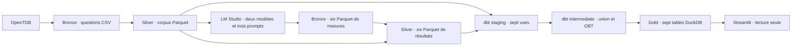

# Trivial Pursuit · Benchmark de LLM locaux

## Contexte et objectif

Ce projet du cours D42, ETL et optimisation des architectures de stockage, a été réalisé du 23 au 26 novembre 2026 en M1 Big Data & IA. Il démontre les étapes d’un pipeline Data Engineering, de l’extraction au dashboard, en comparant deux modèles de langage locaux sur les mêmes questions de culture générale.

## Chiffres clés

| Indicateur | Périmètre |
| --- | --- |
| Corpus OpenTDB | 5 299 questions collectées, 5 290 retenues sur 24 catégories |
| Questions évaluées | 4 501 QCM et 789 vrai/faux, en anglais |
| Benchmark | 2 modèles × 3 prompts × 5 290 questions, soit 31 740 réponses |
| Modélisation | 1 One Big Table (OBT) de 31 740 lignes × 22 colonnes et 7 marts Gold |

## Architecture des données



Le grain de l’OBT est une ligne par question, modèle et prompt. La clé `question_id` relie les mesures au corpus et permet les comparaisons appariées. [Flux détaillés et dictionnaire](documentation/ARCHITECTURE.md#obt-détaillée-dans-dbt-intermediate)

## Technologies

Python prépare les données, Parquet conserve les jeux publiés, dbt avec dbt-duckdb construit les modèles SQL et DuckDB stocke les tables analytiques. LM Studio sert les modèles Gemma 4 E2B et Ministral 3 3B Instruct en local. Streamlit et Plotly assurent la restitution.

<a name="utilisation"></a>
<a name="installation-sous-debian-wsl"></a>

## Reconstruire le projet depuis GitHub

### Prérequis

Prévoir Git, Python 3.13 avec le module `venv` et un accès aux paquets Python pour l’installation. Les commandes ci-dessous utilisent Bash sous Debian, l’environnement de travail de référence sous WSL. Les versions utilisées par dbt et le dashboard sont épinglées dans leurs fichiers de dépendances.

```bash
git clone https://github.com/CecileGUICHARD/trivial-pursuit-data-engineering.git
cd trivial-pursuit-data-engineering
test -d .venv || python3.13 -m venv .venv
source .venv/bin/activate
python -m pip install -r dbt/requirements.txt -r app/requirements.txt
```

### Construire le pipeline dbt et consulter le lignage

Depuis la racine du dépôt, avec l’environnement activé, lancer le build et générer la documentation. Les chemins du profil et des sources sont relatifs à `dbt/`.

```bash
(
  cd dbt &&
  dbt build --profiles-dir . &&
  cp target/run_results.json target/build_run_results.json &&
  dbt docs generate --profiles-dir . --static
)
```

Le build crée `data/trivial_pursuit.duckdb`, avec les vues de staging, la vue d’union, l’OBT et les marts Gold. Dans `dbt/target/static_index.html`, chercher `obt_silver` ou `mart_performance` puis ouvrir **Lineage Graph**. Avec l’OBT déjà construite, `dbt build --profiles-dir . --select path:models/marts` reconstruit les seuls marts depuis `dbt/`. `dbt test --profiles-dir .` y relance les contrôles. [Documentation dbt v1](https://docs.getdbt.com/reference/commands/cmd-docs?version=1.12) · [Grains et mesures Gold](documentation/ARCHITECTURE.md#gold-et-restitution)

### Lancer le dashboard Streamlit

Une fois les sept marts construits, lancer depuis la racine du dépôt avec l’environnement activé.

```bash
streamlit run app/dashboard.py --server.headless true --server.address 127.0.0.1 --server.port 8501 --browser.gatherUsageStats false
```

Ouvrir [le dashboard local](http://127.0.0.1:8501/).

## Reconstruction analytique et rejeu intégral

- **Reconstruction analytique.** Le clone fournit les sept Parquet Silver validés. Le build dbt et le lancement de Streamlit suffisent pour retrouver le lignage, les indicateurs et le dashboard. Après installation des dépendances, cette procédure fonctionne avec les fichiers du clone, sans accès à OpenTDB ni à LM Studio.
- **Rejeu intégral.** Il comprend une nouvelle collecte, la préparation du corpus, les inférences et la consolidation. Il requiert l’API OpenTDB, LM Studio, les variantes de modèles et les outils de la campagne. Les scripts de reprise historiques attendent des empreintes et des journaux locaux précis. Une nouvelle collecte peut changer le corpus, et une nouvelle campagne produit ses propres mesures.

<a name="examiner-la-collecte-existante"></a>
<a name="préparer-les-questions-silver"></a>
<a name="produire-le-candidat-silver"></a>
<a name="protocole-historique-du-pilote-gemma"></a>
<a name="benchmark-complet-gemma-du-lot-4"></a>
<a name="reproduire-la-collecte-dans-un-répertoire-dédié"></a>

[Commandes historiques de collecte, de préparation Silver et d’inférence](documentation/CURRENT.md#procédures-de-rejeu)

### Jeux de données disponibles sur GitHub

Le dépôt contient le [CSV Bronze](data/bronze/questions_raw.csv), le [corpus Silver définitif](data/silver/questions_clean.parquet), douze Parquet des benchmarks complets et les jalons et rapports qualité publiés. Les six exports Silver des benchmarks et le corpus constituent les sept sources du build. [Chemins des sources](documentation/ARCHITECTURE.md#sources-du-silver-préparé) · [Inventaire des fichiers publiés](documentation/CURRENT.md#inventaire-des-données-publiées)

### Source des données

Les questions et réponses proviennent d’Open Trivia Database et de ses contributeurs. Les données OpenTDB redistribuées dans Bronze, Silver et les rapports relèvent de la licence CC BY-SA 4.0. Bronze conserve les valeurs brutes. Les étapes Silver documentent les modifications. En cas de redistribution, conserver l’attribution et le lien vers la licence, signaler les modifications et partager les adaptations sous les mêmes conditions. [Documentation OpenTDB](https://opentdb.com/api_config.php) · [Licence CC BY-SA 4.0](https://creativecommons.org/licenses/by-sa/4.0/)

## Dashboard et résultats

Les quatre onglets comparent les modèles, les prompts, les domaines de connaissance et les questions pièges. Streamlit lit le schéma `gold` en lecture seule. [Vues, filtres et mesures](specifications/DASHBOARD.md)

| Taux de bonnes réponses | P1 · Consigne simple | P2 · Rôle d’expert | P3 · Expert et analyse |
| --- | ---: | ---: | ---: |
| Gemma 4 E2B | 54,12 % | 53,91 % | 52,04 % |
| Ministral 3 3B Instruct | 53,76 % | 52,53 % | 41,25 % |

P1 donne le meilleur taux de réussite aux deux modèles. De P1 à P3, Gemma perd 2,08 points et Ministral 12,51 points. La conformité de Ministral passe de 99,77 % à 78,75 %. Gemma répond plus vite sur chacun des trois prompts dans les conditions mesurées. Sur les 5 290 questions, 308 reçoivent la même réponse incorrecte et conforme dans les six configurations. [Résultats détaillés](documentation/CURRENT.md#comparaison-avec-gemma) · [Référence du hasard et consensus](documentation/CURRENT.md#lot-8-bis--complément-méthodologique-gold)

## Qualité, reproductibilité et limites

- Le dernier build complet documenté valide 16 modèles et 41 tests dbt. Les contrôles vérifient les clés, la couverture, le scoring strict et la concordance entre les Parquet, l’OBT et les marts. Six tests Streamlit ont réussi lors des finitions du dashboard. Leur commande est `python -m unittest discover -s app -p 'test_*.py' -v` depuis la racine, avec la base et l’environnement prêts. [État des validations](documentation/CURRENT.md#contrôles-qualité-effectués)
- Les six configurations partagent les mêmes questions et les mêmes choix ordonnés. Une réponse reçue hors format compte comme incorrecte et la conformité est mesurée séparément. [Protocole](documentation/ARCHITECTURE.md#benchmark)
- Les résultats décrivent ce corpus et une réponse par question et par configuration. Les effectifs varient selon les catégories, certains libellés sont ambigus et les latences dépendent de la machine et des conditions de mesure. [Limites documentées](documentation/CURRENT.md#limites-et-vérifications-restantes)

## Organisation du dépôt

| Emplacement | Contenu |
| --- | --- |
| `data/bronze/`, `data/silver/` | Sources brutes et jeux préparés versionnés |
| `dbt/` | Modèles `staging`, `intermediate` et `marts`, tests SQL et profil local |
| `app/` | Dashboard, dépendances et tests Streamlit |
| Scripts Python à la racine | Collecte, exploration, préparation Silver, pilotes et benchmarks |
| `documentation/`, `specifications/` | Référence technique, suivi, décisions et spécification du dashboard |

## Documentation détaillée

- [Architecture technique, dictionnaire et protocole](documentation/ARCHITECTURE.md)
- [État définitif et historique des réalisations](documentation/CURRENT.md)
- [Registre des décisions et de leurs justifications](documentation/DECISIONS.md)
- [Spécification du dashboard](specifications/DASHBOARD.md) · [Consignes du dépôt](AGENTS.md)
