# Architecture technique

L’architecture suit le schéma du cours D42. Bronze conserve les données brutes, Silver fournit les Parquet préparés par Python, et dbt lit ces fichiers dans `staging` puis construit la One Big Table (OBT) dans `intermediate`. Gold contient les marts métier dans DuckDB. Streamlit consomme ces tables pour restituer le benchmark. [Suivi opérationnel](CURRENT.md) · [Registre des décisions](DECISIONS.md)

## Choix validés

```mermaid
flowchart LR
    API[OpenTDB] --> Bronze[Bronze · CSV]
    Bronze --> Conversion[Silver · Parquet avant dédoublonnage]
    Conversion --> Questions[Silver · questions dédoublonnées en Parquet]
    Questions --> Normalisees[Silver · questions normalisées en Parquet]
    Normalisees --> Candidat[Silver · candidat final et rapport qualité]
    Candidat -->|Validation définitive| Benchmark[Silver préparé · corpus OpenTDB]
    Benchmark --> Pilote[Silver · manifeste du pilote]
    Benchmark --> Prompt[Question et choix ordonnés]
    Prompt --> LM[LM Studio · inférences locales]
    Pilote --> LM
    LM --> Journal[Journal DuckDB local]
    Journal --> Mesures[Bronze · Parquet par modèle et prompt]
    Mesures --> Resultats[Silver préparé · six Parquet de benchmark]
    Benchmark --> Resultats
    Benchmark --> QuestionsStaging[dbt staging · corpus typé]
    Resultats --> ResultatsStaging[dbt staging · benchmarks typés]
    ResultatsStaging --> Union[dbt intermediate · UNION ALL des six benchmarks]
    Union --> OBT[dbt intermediate · table intermediate.obt_silver]
    QuestionsStaging -->|JOIN sur question_id| OBT
    OBT --> Gold[Gold · sept tables métier dans DuckDB]
    Gold -->|Lecture seule| App[Consommation · dashboard Streamlit]
```



### Bronze

`collect_opentdb_complet.py` collecte les questions par catégorie, utilise un jeton de session et enregistre la progression dans un fichier local. L’extraction est conservée dans `data/bronze/questions_raw.csv` avec les champs `type`, `difficulty`, `category`, `question`, `correct_answer` et `incorrect_answers`. La liste des réponses incorrectes est sérialisée en JSON dans la cellule CSV. Les entités HTML et les valeurs sources sont conservées pour pouvoir vérifier les transformations ultérieures. Les données brutes OpenTDB et les mesures brutes des LLM restent intactes lors de la consolidation Silver.

### Silver

Les étapes validées de conversion, dédoublonnage et normalisation ont produit trois jalons. Le Parquet de conversion contient six chaînes, dont le JSON des distracteurs. Le fichier `questions_dedoublonnees.parquet` conserve les six champs bruts après les quatre arbitrages de dédoublonnage. La normalisation parse le JSON des distracteurs, décode les entités HTML, compose les textes en NFC, retire les espaces périphériques et réduit les espaces ordinaires répétés. Elle conserve les espaces insécables isolés. `questions_normalisees.parquet` stocke les six champs normalisés, dont `incorrect_answers` comme liste de chaînes. [Historique des jalons](CURRENT.md#inventaire-des-fichiers-silver)

`preparer_silver.py finaliser` part de `questions_normalisees.parquet` et du classement du diagnostic existant. L’empreinte du jalon, l’identifiant de proposition, le rang, le champ et le texte original rattachent chaque correction historique à la bonne valeur. Après enrichissement, le script vérifie les dix couples `question_id` et libellé exact des cinq groupes validés, puis écarte les cinq lignes marquées `EXCLURE`. Le candidat et le rapport qualité sont écrits dans `candidat_final_5290/`. Le corpus courant compte 5 290 lignes × 10 colonnes. Le rapport conserve les décisions historiques et les dix décisions GARDER/EXCLURE, dont les rangs renvoient au corpus de 5 295 lignes avant exclusion. [Silver courant](../data/silver/questions_clean.parquet) · [Rapport qualité](../data/silver/rapport_qualite_silver.csv)

| Champ ajouté | Type Parquet | Règle |
| --- | --- | --- |
| `question_id` | `VARCHAR` | SHA-256 de la sérialisation JSON de catégorie, difficulté, type, libellé, bonne réponse et distracteurs triés. Stable pour un même contenu lorsque l’ordre des lignes ou des distracteurs varie. |
| `answer_choices` | `VARCHAR[]` | Ordre commun aux expériences. Le tri utilise le SHA-256 de `["choix", 42, question_id, réponse]`, puis le texte pour départager une éventuelle égalité. |
| `expected_answer` | `VARCHAR` | Lettre `A` à `D` selon la position de la bonne réponse pour un QCM. Chaîne `True` ou `False` pour un vrai/faux. |
| `category_id` | `INTEGER` | Identifiant officiel OpenTDB associé par égalité exacte du libellé Silver. Les 24 couples sont figés dans le script pour garantir la reproduction hors ligne. |

Le contrôle compare les six champs source avant et après, vérifie les effectifs, les types et les choix, puis recalcule identifiants, ordre des choix et réponse attendue après inversion des lignes et des distracteurs. Les identifiants et les libellés répétés sont contrôlés après relecture du Parquet. Les empreintes des jalons et du Bronze sont comparées avant publication. [Catalogue officiel OpenTDB](https://opentdb.com/api_category.php)

Le contrôle des doublons de libellé calcule une clé de comparaison en NFC avec repli de casse, retrait des espaces Unicode, des caractères de ponctuation Unicode et des guillemets assimilés. `controler-doublons` expose les groupes repérés et leurs identifiants à partir du Silver courant. La clé reste limitée à la comparaison. Les exclusions proviennent exclusivement des identifiants et libellés validés.

`pilote_gemma.py manifeste` conserve `pilot_order`, `question_id` et `seed`. Pour un nouveau tirage, la taille est de 10 % de la population, arrondie au plus proche avec les demis à l’entier supérieur. Les quotas des strates `category × difficulty × type` suivent les plus forts restes et le départage lexicographique. Le SHA-256 du JSON compact `["pilote",42,question_id]` fixe la sélection et l’ordre de passage. Le pilote mesuré conserve ses 530 identifiants issus du Silver initial. `manifest_metadata.json` enregistre séparément le SHA-256 du Silver actif, celui du corpus utilisé pour le tirage et celui du manifeste.

### Mesures Bronze et résultats Silver

`pilote_gemma.py executer` journalise chaque tentative dans le DuckDB local avant et après l’appel. Toutes les 25 tentatives et à la fin d’un bloc, chaque Parquet est remplacé atomiquement, d’abord dans Bronze pour la combinaison modèle et prompt, puis dans Silver. Les deux couches portent les fichiers `gemma_p1_choices.parquet` et `gemma_p2_expert.parquet`. `reconstruire-bronze` reproduit les mesures depuis le journal. `structurer` reproduit les résultats à partir des Parquet Bronze, du manifeste et des questions Silver. Ces deux opérations fonctionnent hors ligne.

`pilote_gemma.py executer-p3` utilise le même chemin d’inférence, de journalisation, d’export et de scoring sur le manifeste de 530 questions. Le bloc écrit dans `data/silver/pilot_lot2/pilot_p3.duckdb` et produit `gemma_p3_expert_advanced.parquet` à la racine de chaque couche. Avant le bloc, le script vérifie le moteur LM Studio sélectionné et compare la configuration effective à celle du pilote historique, avec une empreinte propre au gabarit P3. `pilote_gemma.py bilan-p3` compare les trois résultats en ouvrant les deux journaux en lecture seule.

| Couche | Champs | Information portée |
| --- | --- | --- |
| Bronze et Silver | `question_id`, `model_id`, `prompt_id`, `inference_id` | Identifiants de la question, du modèle, du prompt et de la tentative |
| Bronze et Silver | `raw_response`, `response_time`, `status`, `error_type`, `error_message` | Texte brut, latence en secondes, statut et diagnostic technique observés |
| Bronze et Silver | `configuration` | Réglages de génération, versions, modèle chargé et empreintes |
| Bronze | `pilot_order`, `segment_id` | Rang du manifeste et identifiant du segment du journal |
| Silver | `ai_answer`, `ai_correct`, `format_valid` | Réponse extraite, exactitude et conformité calculées pour les réponses reçues |

Le journal local conserve les horaires et les durées actives des segments. La reprise contrôle les configurations et les empreintes, puis traite les combinaisons encore absentes. Lorsqu’une interruption laisse la réception indéterminée, l’entrée reçoit le statut `interrupted` et reste conservée avec son identifiant. Une réponse reçue reste réutilisable, y compris lorsqu’elle est hors format. Les exports se joignent au corpus par `question_id` et entre couches par `inference_id`.

La configuration de reprise du journal pointe vers le SHA-256 du corpus actif. Les configurations par tentative conservent le SHA-256 du corpus effectivement utilisé lors de la mesure. Les 1 060 tentatives du pilote ont servi à reconstruire les deux couches. Le manifeste conserve son empreinte initiale.

Pour le lot 4, `benchmark_gemma.py` copie le journal local du pilote et fixe un manifeste de 5 290 questions. L’ordre reprend les 530 rangs du pilote, puis l’ordre du Silver pour les 4 760 questions restantes. Les deux premiers prompts partagent cet ordre. Le contrôle d’exécution compare le moteur sélectionné et la configuration effective aux paramètres du pilote. Les exports P1 et P2 sont versionnés dans `data/bronze/benchmark_lot4/` et `data/silver/benchmark_lot4/`. Le journal et le manifeste d’exécution sont locaux.

`benchmark_gemma.py executer --p3` reprend le même manifeste et initialise `data/silver/benchmark_lot4/benchmark_p3.duckdb` par copie du journal du pilote P3. L’empreinte du manifeste complet remplace celle du pilote dans la configuration de reprise. Chaque tentative du pilote conserve sa configuration, sa réponse brute, son identifiant et sa latence. Le contrôle compare l’empreinte du gabarit et les autres réglages au pilote P3, puis le bloc envoie uniquement les questions dont le journal ne contient pas de tentative. Les réponses hors format sont conservées avec leur score incorrect. Les deux Parquet P3 complets sont versionnés sous `data/bronze/benchmark_lot4/` et `data/silver/benchmark_lot4/`. `benchmark_gemma.py bilan --p3` compare les trois prompts depuis les deux journaux complets.

Le contrôle de clôture a retrouvé les 5 290 identifiants du corpus une fois par prompt dans chaque couche. Les trois prompts suivent le même ordre et les champs communs concordent ligne par ligne entre Bronze et Silver, avec 15 870 `inference_id` distincts. Les 530 lignes réutilisées de P3 sont identiques aux lignes du pilote à la relecture des deux couches. Le scoring strict recalculé concorde avec les trois tables Silver. [Résultats et durées définitifs](CURRENT.md#comparaison-complète-des-trois-prompts)

### Sources du Silver préparé

Le corpus OpenTDB final et les six résultats complets Gemma 4 E2B et Ministral 3 3B Instruct restent dans sept Parquet distincts déjà validés. Les chemins sont relatifs à la racine du dépôt.

| Source | Chemin | Volume validé | Disponibilité |
| --- | --- | ---: | --- |
| Corpus OpenTDB | `data/silver/questions_clean.parquet` | 5 290 lignes × 10 colonnes | Versionné |
| Gemma P1 | `data/silver/benchmark_lot4/gemma_p1_choices.parquet` | 5 290 réponses | Versionné |
| Gemma P2 | `data/silver/benchmark_lot4/gemma_p2_expert.parquet` | 5 290 réponses | Versionné |
| Gemma P3 | `data/silver/benchmark_lot4/gemma_p3_expert_advanced.parquet` | 5 290 réponses | Versionné |
| Ministral P1 | `data/silver/benchmark_ministral_lot4/ministral_p1_choices.parquet` | 5 290 réponses | Versionné |
| Ministral P2 | `data/silver/benchmark_ministral_lot4/ministral_p2_expert.parquet` | 5 290 réponses | Versionné |
| Ministral P3 | `data/silver/benchmark_ministral_lot4/ministral_p3_expert_advanced.parquet` | 5 290 réponses | Versionné |

Les six exports complets incluent déjà les mesures Gemma et Ministral réutilisées lors de la reprise. Les fichiers de pilote séparés et les 13 échecs de transport de la table `echecs_transport_reprise` relèvent de la traçabilité. Les pilotes Bonsai et Qwen sont hors du périmètre de l’OBT et des agrégations Gold. Les réponses reçues hors format sont présentes dans l’OBT et comptent comme incorrectes au scoring strict. [Arbitrage du deuxième modèle](CURRENT.md#choix-définitif-du-deuxième-modèle) · [Journal d’audit](../data/silver/benchmark_ministral_lot4/benchmark.duckdb)

### OBT détaillée dans dbt intermediate

La table `intermediate.obt_silver` est matérialisée dans la base locale `data/trivial_pursuit.duckdb`. Sept vues du schéma `staging` lisent les Parquet Silver déclarés avec `source()`. DuckDB conserve leurs types natifs. La vue `intermediate.int_benchmark_results` réunit les six vues de benchmark avec `UNION ALL BY NAME`, qui préserve une éventuelle colonne propre à une source et place `NULL` dans les branches où elle est absente. L’OBT référence cette vue et `staging.stg_opentdb` avec `ref()` et effectue une jointure interne sur `question_id`. La clé commune est fusionnée et le schéma observé présente zéro autre collision de noms. [Sources dbt](../dbt/models/staging/sources.yml) · [Modèle de l’OBT](../dbt/models/intermediate/obt_silver.sql)

La granularité est une ligne par triplet (`question_id`, `model_id`, `prompt_id`). La construction a produit **31 740 lignes et 22 colonnes**, avec six inférences pour chacune des 5 290 questions distinctes. Les identifiants source, les réponses brutes, le scoring strict, les statuts, les latences et les métadonnées techniques sont repris à l’identique.

Une granularité commune permet d’apparier les mesures par `question_id` pour comparer les modèles à prompt fixé ou les prompts à modèle fixé. Centraliser l’union et la jointure dans dbt permet de reproduire la consolidation à partir des mêmes sources validées et de rattacher chaque résultat à l’inférence d’origine. Les indicateurs Gold appliqueront les mêmes définitions de l’exactitude stricte, de la conformité et des latences à un périmètre commun de réponses reçues. [Définitions des mesures](#benchmark)

La dénormalisation répète les attributs OpenTDB, comme le libellé, la catégorie et la difficulté, sur six lignes par question. Ce coût de stockage permet aux analyses de réutiliser la jointure préparée. Au niveau de l’OBT, `COUNT(*)` compte les inférences dans le périmètre filtré et `COUNT(DISTINCT question_id)` compte les questions couvertes.

#### Dictionnaire des colonnes de l’OBT

La provenance « Benchmarks » désigne `int_benchmark_results`, issu des six exports Silver. « OpenTDB » désigne `stg_opentdb`, issu de `questions_clean.parquet`. Les six Parquet de benchmark ont les mêmes 13 colonnes et les mêmes types. Le Parquet OpenTDB compte 10 colonnes. Les 22 noms d’origine sont conservés, avec fusion de la seule clé `question_id` et zéro renommage.

| Colonne | Type DuckDB | Description | Origine et renommage |
| --- | --- | --- | --- |
| `question_id` | `VARCHAR` | Identifiant stable SHA-256 de la question. | Benchmarks et OpenTDB · clé fusionnée, nom d’origine |
| `model_id` | `VARCHAR` | Identifiant réel du modèle renvoyé par LM Studio. | Benchmarks |
| `prompt_id` | `VARCHAR` | Identifiant du gabarit P1, P2 ou P3. | Benchmarks |
| `inference_id` | `UUID` | Identifiant unique de l’inférence d’origine. | Benchmarks |
| `raw_response` | `VARCHAR` | Réponse brute, y compris texte hors format et chaîne vide. | Benchmarks |
| `ai_answer` | `VARCHAR` | Réponse extraite au scoring si le format est conforme. `NULL` sinon. | Benchmarks |
| `ai_correct` | `BOOLEAN` | Résultat historique de l’évaluation stricte. | Benchmarks |
| `response_time` | `DOUBLE` | Latence HTTP historique en secondes jusqu’à réception complète. | Benchmarks |
| `format_valid` | `BOOLEAN` | Conformité historique au format de réponse demandé. | Benchmarks |
| `status` | `VARCHAR` | Statut d’origine de la tentative. Les exports définitifs contiennent `received`. | Benchmarks |
| `configuration` | `VARCHAR` | JSON textuel d’origine avec réglages, versions et empreintes. | Benchmarks |
| `error_type` | `VARCHAR` | Type d’erreur technique consigné. Valeurs `NULL` dans ces exports. | Benchmarks |
| `error_message` | `VARCHAR` | Diagnostic technique consigné. Valeurs `NULL` dans ces exports. | Benchmarks |
| `type` | `VARCHAR` | Type OpenTDB `multiple` ou `boolean`. | OpenTDB |
| `difficulty` | `VARCHAR` | Difficulté OpenTDB `easy`, `medium` ou `hard`. | OpenTDB |
| `category` | `VARCHAR` | Libellé de la catégorie OpenTDB. | OpenTDB |
| `question` | `VARCHAR` | Libellé anglais préparé pour le benchmark. | OpenTDB |
| `correct_answer` | `VARCHAR` | Texte de la bonne réponse de référence. | OpenTDB |
| `incorrect_answers` | `VARCHAR[]` | Liste des distracteurs dans l’ordre source Silver. | OpenTDB |
| `answer_choices` | `VARCHAR[]` | Liste des choix dans l’ordre de présentation figé. | OpenTDB |
| `expected_answer` | `VARCHAR` | Référence de scoring, lettre A à D ou `True` ou `False`. | OpenTDB |
| `category_id` | `INTEGER` | Identifiant officiel de la catégorie OpenTDB. | OpenTDB |

Les scores `ai_correct` et `format_valid` sont recalculables, `category` correspond à un `category_id`, et les deux champs d’erreur sont actuellement entièrement nuls. Ce sont des candidats à un arbitrage de simplification. Les champs restent utiles pour conserver la trace originale du scoring, la lisibilité des catégories et le schéma d’audit. `raw_response` et `ai_answer` portent le texte intégral et l’extraction respectivement. `correct_answer`, `expected_answer` et `answer_choices` portent le texte, le code attendu et l’ordre de présentation. Le modèle conserve l’ensemble de ces champs.

#### Qualité et lignage dbt

Les tests vérifient les effectifs globaux, les six combinaisons modèle–prompt, la couverture par question, l’unicité du triplet et des UUID, les clés obligatoires et les domaines autorisés. Le test de relation en amont vérifie la présence de chaque `question_id` de benchmark dans le corpus. Le contrôle de schéma compare les noms et les types de l’OBT aux vues sources après fusion de la clé.

Deux tests comparent directement aux Parquet les 13 colonnes de benchmark et les 10 colonnes du corpus, répliquées six fois dans le second cas. Les `EXCEPT ALL` dans les deux sens comparent les valeurs et leur multiplicité, y compris les `NULL`, les listes et leur ordre. Le test de scoring recalcule la conformité et l’exactitude pour comparaison avec les valeurs historiques. Le reclassement a également été vérifié contre la table de référence `silver.obt_silver` du jalon `e76715e`, conservée dans `data/silver/obt_silver.duckdb`. [Tests SQL](../dbt/tests/) · [Contrôles D42](CURRENT.md#alignement-sur-le-schéma-d42)

La documentation dbt générée expose le graphe des sept sources, des vues de staging, de l’OBT et des marts Gold. Pour ouvrir le graphe, charger `dbt/target/static_index.html` dans un navigateur local, sélectionner `obt_silver` puis ouvrir **Lineage Graph**. [Procédure reproductible](../README.md#construire-le-pipeline-dbt-et-consulter-le-lignage)

### Gold et restitution

Les scripts Python produisent les Parquet Silver. Le lignage dbt commence à ces fichiers et traverse `staging` puis `intermediate`. La cible locale affecte les modèles `marts` au schéma `gold`. Les sept marts sont matérialisés en tables dans `data/trivial_pursuit.duckdb`. Six lisent uniquement `intermediate.obt_silver` par `ref('obt_silver')`. Le septième, `mart_category_gap`, réutilise les agrégats de `mart_category`. [Nommage des schémas](../dbt/macros/generate_schema_name.sql) · [Modèles et dictionnaire Gold](../dbt/models/marts/marts.yml)

| Mart | Grain | Lignes × colonnes | Calcul et dimensions |
| --- | --- | ---: | --- |
| `mart_performance` | `model_id`, `prompt_id` | 6 × 11 | Effectif et pourcentage des réponses correctes, incorrectes conformes et hors format. Conformité et latence moyenne. |
| `mart_prompt_comparison` | `model_id`, `prompt_from`, `prompt_to` | 6 × 17 | Auto-jointure par `question_id` et modèle. P2−P1, P3−P1 et P3−P2. Effectifs des quatre transitions, mesures avant/après et écarts. |
| `mart_category` | `model_id`, `prompt_id`, `category_id` | 144 × 7 | Libellé `category`, effectif, bonnes réponses et réussite stricte. |
| `mart_category_gap` | `prompt_id`, `category_id` | 72 × 7 | Appariement des deux modèles dans `mart_category`, libellé `category`, taux par modèle, écart signé Gemma − Ministral et égalité. |
| `mart_difficulty` | `model_id`, `prompt_id`, `difficulty`, `type` | 54 × 9 | Effectifs, réussite stricte, référence du hasard et écart en points pour `multiple`, `boolean` et le total `all`. |
| `mart_question_type` | `model_id`, `prompt_id`, `type` | 12 × 9 | Effectifs, réussite stricte, référence du hasard, écart en points et conformité pour les QCM et les vrai/faux. |
| `mart_question_outcomes` | `question_id` | 5 290 × 14 | Dix attributs OpenTDB, nombre de configurations distinctes, classe `all_correct`, `all_incorrect` ou `mixed` et consensus incorrect. |

`mart_difficulty` produit les lignes ventilées et les totaux avec `GROUPING SETS`. `chance_pct` vaut 25 % pour un QCM à quatre choix et 50 % pour un vrai/faux. Pour `type = 'all'`, il vaut `(25 × nombre de QCM + 50 × nombre de vrai/faux) / effectif total` à chaque difficulté. Les lignes `all` couvrent les mêmes réponses que les lignes ventilées. Les deux marts exposent l’écart signé `above_chance_pp = success_pct − chance_pct`. Dans `mart_question_type`, `compliance_pct` rapporte le nombre de `format_valid` vrais au nombre de réponses reçues.

`mart_question_outcomes` conserve les dix attributs OpenTDB, dont les distracteurs, l’ordre des choix et la valeur attendue par le scoring strict. `unanimous_wrong` vaut vrai si la question compte exactement six lignes, six configurations distinctes et six réponses avec `ai_correct = false`, `format_valid = true` et `ai_answer` non NULL, et si les six valeurs de `ai_answer` sont identiques. `same_wrong_answer` porte cette valeur commune, qui est la lettre du QCM ou `True`/`False`. Il vaut `NULL` dans les autres cas. Le consensus incorrect est un sous-ensemble de `all_incorrect`.

Les taux sont des pourcentages des réponses reçues ou des paires. Les réponses hors format restent incorrectes au scoring et constituent un statut séparé dans `mart_performance`. Les écarts de taux sont exprimés en points de pourcentage, et les latences en secondes. Les calculs conservent leur précision jusqu’à l’affichage. Pour une catégorie, l’égalité compare les proportions via les produits croisés des effectifs.

Des marts spécialisés fixent le grain de chaque usage et gardent les dimensions nécessaires aux futurs filtres. La performance par configuration, les transitions appariées et la classification par question ont des dénominateurs différents. Les séparer évite de les confondre. `mart_category_gap` réutilise le grain déjà contrôlé de `mart_category` et calcule l’écart à partir des mêmes taux.

Les 14 tests Gold vérifient les grains, les volumes et les KPI par rapprochement avec l’OBT. Les tests du lot 8 bis reconstituent les totaux par difficulté à partir des lignes ventilées, vérifient les taux et retrouvent les consensus depuis les réponses conformes incorrectes. Le contrôle des transitions reconstruit les paires par pivot des scores. Les moyennes de latence sont comparées avec une tolérance de `1e-10` seconde pour les calculs flottants. Les 27 tests historiques ont aussi été rejoués. [Résultats du lot 8 bis](CURRENT.md#lot-8-bis--complément-méthodologique-gold) · [Procédure dbt](../README.md#construire-le-pipeline-dbt-et-consulter-le-lignage)

### Dashboard Streamlit

`app/dashboard.py` initialise les quatre onglets. `app/gold.py` lit exclusivement les sept tables `gold` et ferme la connexion DuckDB après chargement. Le cache en mémoire est invalidé quand la taille ou la date de modification de la base change. Les fonctions de `app/views.py` filtrent les lignes au grain des marts et délèguent les graphiques à `app/charts.py`. `app/presentation.py` et `app/dashboard.css` définissent le bandeau, les cartes et la réinitialisation par vue.

Les graphiques utilisent directement les taux, les latences et les écarts Gold. La seule synthèse calculée dans l’interface porte sur les effectifs et proportions des questions filtrées, à partir des classes et indicateurs déjà renseignés dans `mart_question_outcomes`. Les résultats de cet onglet restent fondés sur les six configurations. [Spécification du dashboard](../specifications/DASHBOARD.md) · [Installation et lancement](../README.md#lancer-le-dashboard-streamlit)

### Benchmark

Le pilote utilise Gemma 4 E2B via l’API `POST /api/v1/chat` de LM Studio. Chaque prompt est exécuté une fois par question, dans l’ordre `pilot_order`, avec des requêtes indépendantes. Les blocs historiques `P1_choices` puis `P2_expert` et le bloc ajouté `P3_expert_advanced` commencent chacun après le même échauffement sur une question synthétique. L’ordre des blocs et le moment de leur exécution peuvent influencer les latences si la température ou la charge du matériel évolue.

Les réglages communs sont `temperature=0`, `top_k=1`, `top_p=1`, `min_p=0`, `repeat_penalty=1`, `max_output_tokens=16`, `context_length=4096`, `reasoning="off"`, `stream=false`, `store=false`. Le client applique un délai maximal de 60 secondes à chaque appel. [API LM Studio](https://lmstudio.ai/docs/developer/rest/chat)

`P1_choices` utilise le gabarit suivant pour les QCM, en étiquetant les choix `A` à `D` dans l’ordre de `answer_choices`.

```text
Answer the following general knowledge question. Reply with only one uppercase letter: A, B, C, or D.

{question}

{propositions étiquetées, une par ligne}
```

Pour un vrai/faux, la consigne de réponse est `Reply with only True or False.` et les choix sont affichés dans l’ordre de `answer_choices` sans lettres. `P2_expert` ajoute uniquement `You are a general knowledge expert.` sur une ligne avant le texte de `P1_choices`.

`P3_expert_advanced` reprend `P2_expert` et insère une consigne par ligne immédiatement après `You are a general knowledge expert.`. Pour un QCM, les lignes sont les suivantes.

```text
Carefully analyze the question and evaluate each answer choice.
Use your factual knowledge to eliminate incorrect options.
Check your answer before responding.
```

Pour un vrai/faux, les lignes sont les suivantes.

```text
Carefully evaluate the statement using your factual knowledge.
Check its accuracy before responding.
```

Le prompt contient uniquement la consigne, `question` et les éléments de `answer_choices`. Le type sert localement à choisir le gabarit. `question_id` identifie la mesure locale. `correct_answer`, `incorrect_answers` et `expected_answer` restent dans les données de référence et l’évaluation compare localement la réponse du modèle à `expected_answer`.

#### Indépendance conversationnelle

Les journaux LM Studio confirment que les 10 580 requêtes mesurées et les quatre échauffements ont été envoyés avec `"store": false`, sans `previous_response_id` ni historique de messages. Chaque appel transmet un seul texte avec la consigne, la question et ses choix. La bonne réponse figure parmi les choix sans indication de sa validité. La référence `expected_answer` sert uniquement au scoring local. Le script confirme la construction du texte complet et le contrôle côté serveur compare les extraits d’`input` lorsque les journaux abrègent ce champ. [Script d’inférence](../pilote_gemma.py) · [API de conversation LM Studio](https://lmstudio.ai/docs/developer/rest/chat)

Entre `P1_choices` et `P2_expert`, le script poursuit sur l’instance `gemma-pilote-lot3` et lance l’échauffement synthétique du second bloc. Il ne commande aucun déchargement ni aucune réinitialisation du cache. Les journaux consultés ne montrent pas d’événement de ce type entre les blocs. L’audit porte sur le contexte de conversation et les opérations observables. Il ne mesure pas l’état du cache interne du moteur.

Les 5 290 requêtes P3 et les deux échauffements utilisent la même instance. Le journal serveur confirme `store=false` et un historique d’un seul message pour chaque appel. Les extraits d’`input` correspondent aux prompts attendus dans l’ordre du manifeste.

| Mesure | Calcul par prompt |
| --- | --- |
| Précision | Réponses correctes divisées par réponses reçues. Une réponse conforme doit correspondre à `expected_answer`. Une réponse hors format compte comme incorrecte. |
| Respect du format | Réponses conformes divisées par réponses reçues. Après retrait des espaces périphériques, une lettre `A`, `B`, `C` ou `D` est attendue pour un QCM, et `True` ou `False` pour un vrai/faux. |
| Latence moyenne et médiane | Temps monotone de l’appel HTTP jusqu’à la réception complète, mesuré par `curl` pour toutes les réponses reçues. |
| Erreurs techniques | Nombre et part des requêtes en échec parmi les requêtes tentées, avec ventilation par type d’erreur. Les délais d’attente expirés, erreurs HTTP et réponses API illisibles sont des erreurs techniques. |
| Durée active | Temps mural actif par bloc, incluant les échecs et la persistance, hors échauffements et pauses entre segments. |

La projection historique du pilote multiplie sa durée active par `5 290 / 530`. L’estimation du temps restant utilisait le nombre de questions encore à mesurer, divisé par 530. Le bilan définitif cumule les durées réellement mesurées lors du pilote et du lot 4. Les comparaisons par catégorie, difficulté et type indiquent leurs effectifs. Un choix uniforme au hasard donne 25 % de bonnes réponses sur un QCM à quatre choix et 50 % sur un vrai/faux.

### Pilote Bonsai 27B

Le pilote s’est arrêté à la demande de l’utilisatrice après 41 réponses. Bonsai a été déchargé et l’utilisatrice a validé la clôture définitive du modèle pour ce benchmark. [Mesures partielles et motif d’arrêt](CURRENT.md#pilote-bonsai-27b-arrêté-et-modèle-abandonné)

L’instance `bonsai-pilote` charge `prism-ml/bonsai-27b`, variante `prism-ml/bonsai-27b@q1_0`. L’API LM Studio indique une architecture `qwen35`, 27 milliards de paramètres et un contexte maximal de 262 144 tokens. PrismML indique une base Qwen3.6-27B à attention hybride. Le contexte utilisé par le pilote est de 4 096 tokens. LM Studio `0.4.28+2` utilise le moteur `llama.cpp-win-x86_64-vulkan-avx2@2.80.1` sous Windows. Le modèle a chargé en 37,02 s après le déchargement de Gemma. [Fiche PrismML](https://huggingface.co/prism-ml/Bonsai-27B-gguf) · [Conversion LM Studio Community](https://huggingface.co/lmstudio-community/Bonsai-27B-GGUF)

| Fichier installé | Taille en octets | SHA-256 mesuré |
| --- | ---: | --- |
| `Bonsai-27B-Q1_0.gguf` | 3 803 452 576 | `71d6871836886267f39f1ac69b1b1dd8a783970708d7a189960112ed02978901` |
| `mmproj-Bonsai-27B-BF16.gguf` | 931 145 888 | `c4c09d300638f6d2759e1ffe94d97cf08be94b8c9dad6920509be1aab11fd8cb` |

L’empreinte du modèle texte concorde avec celle publiée par LM Studio Community. L’API rapporte 4 734 614 604 octets pour l’ensemble. Le serveur a chargé le projecteur multimodal BF16 et les requêtes du pilote contiennent uniquement du texte. [Empreinte publiée du GGUF](https://huggingface.co/lmstudio-community/Bonsai-27B-GGUF/blob/main/Bonsai-27B-Q1_0.gguf)

LM Studio a choisi automatiquement la répartition CPU/GPU sur l’Intel Core i5-1235U et l’Intel UHD Graphics. L’instance rapporte quatre créneaux, un lot logique de 2 048 tokens, un lot physique de 512 tokens, 32 points de reprise de contexte, Flash Attention activée et un cache KV placé sur le GPU. Le journal moteur signale un traitement Flash Attention sur CPU pour une couche placée sur Vulkan. Le décodage spéculatif est désactivé. Le pilote envoie les requêtes une par une.

`pilote_bonsai.py manifeste` reprend les 30 premiers rangs du [manifeste Gemma validé](../data/silver/pilot_lot2/pilot_question_ids.parquet), dans leur ordre d’origine. L’échantillon comprend 27 QCM et 3 vrai/faux, avec 10 questions faciles, 13 intermédiaires et 7 difficiles sur 13 catégories. Le [manifeste Bonsai](../data/silver/pilote_bonsai/pilot_question_ids.parquet) porte le SHA-256 `79d2d9c59f0aa56b16af8e1b6a9b2583dbc510f2cb0fe9e98cf05a8055e3a560`. Les trois blocs utilisent ces mêmes identifiants, les choix ordonnés du Silver et les fonctions de construction des prompts et de scoring du pilote Gemma.

`pilote_bonsai.py executer` vérifie le moteur sélectionné et la configuration de l’instance, puis réutilise le client HTTP, le journal DuckDB, les exports Bronze et la structuration Silver. Chaque appel mesuré utilise un seul texte et `store=false`. Les réglages d’inférence, le délai HTTP de 60 s et l’échauffement synthétique avant chaque bloc suivent le protocole Gemma. Les artefacts du pilote sont locaux, sous [Bronze](../data/bronze/pilote_bonsai/) et [Silver](../data/silver/pilote_bonsai/). Chaque couche contient un Parquet `bonsai_*.parquet` par prompt exécuté. Le journal `pilot.duckdb` de Silver conserve les réglages et les mesures de chaque tentative. [Exécution du pilote](../pilote_bonsai.py)

`pilote_bonsai.py bilan` lit le journal et calcule les projections de durée active pour les blocs complets. Il reproduit aussi l’extrapolation globale du pilote arrêté en multipliant la latence moyenne des 41 réponses reçues par les 15 870 inférences prévues sur les trois prompts. [Calcul et limites](CURRENT.md#pilote-bonsai-27b-arrêté-et-modèle-abandonné)

### Pilote Qwen3-4B-Instruct-2507

Le test de faisabilité utilise `qwen/qwen3-4b-2507@q4_k_m` avec l’identifiant `qwen-benchmark-lot4`, le contexte de 4 096 tokens et le moteur `llama.cpp-win-x86_64-vulkan-avx2@2.80.1` sous LM Studio `0.4.28+2`. Le fichier `Qwen3-4B-Instruct-2507-Q4_K_M.gguf` pèse 2 497 459 753 octets. Son SHA-256 `8cdb57cbb880d313736a9bc4e3d3d2485f145b5e19cf33783746e753e82641fc` concorde avec celui publié par LM Studio Community. [Fiche LM Studio](https://lmstudio.ai/models/qwen/qwen3-4b-2507) · [Empreinte publiée du GGUF](https://huggingface.co/lmstudio-community/Qwen3-4B-Instruct-2507-GGUF/blob/main/Qwen3-4B-Instruct-2507-Q4_K_M.gguf)

`pilote_qwen.py executer` lit le manifeste Bonsai d’origine, contrôle son empreinte et vérifie le moteur et l’instance. Il envoie une requête indépendante par question via `POST /api/v1/chat`, dans l’ordre du manifeste, et effectue un échauffement synthétique avant chaque bloc. Le client commun reprend les gabarits, les choix ordonnés, le scoring strict et les paramètres Gemma. Le champ `reasoning` est omis pour la variante Instruct, qui fonctionne uniquement sans mode de réflexion. Les autres réglages de génération, `stream=false`, `store=false` et le délai HTTP de 60 s suivent le protocole Gemma. [Script d’exécution](../pilote_qwen.py)

Le journal `pilot.duckdb` et les six Parquet `qwen_*.parquet` restent locaux dans les répertoires `pilote_qwen/` des deux couches. `pilote_qwen.py bilan` recalcule les métriques et extrapole la durée à partir du temps actif observé dans chacun des trois blocs. Le test validé couvre 30 questions par prompt. La comparaison Gold exclut les mesures Qwen à la suite de la sélection de Ministral. [Résultats du test](CURRENT.md#test-de-faisabilité-qwen3-4b-instruct-2507)

### Pilote Ministral-3-3B-Instruct-2512

Le test utilise `mistralai/ministral-3-3b@q4_k_m`, chargé sous `ministral-benchmark-lot4` avec un contexte de 4 096 tokens, LM Studio `0.4.28+2` et le moteur `llama.cpp-win-x86_64-vulkan-avx2@2.80.1`. Le fichier texte `Ministral-3-3B-Instruct-2512-Q4_K_M.gguf` pèse 2 146 498 240 octets. Son SHA-256 `ee46f8f2cc4acf15e89699563e23b4a3919dce2e9ce7c44b53778d6590318e96` concorde avec l’empreinte publiée. LM Studio a aussi chargé le projecteur multimodal F16. Les requêtes transmettent uniquement du texte. [Fiche LM Studio](https://lmstudio.ai/models/mistralai/ministral-3-3b) · [Empreinte publiée du GGUF](https://huggingface.co/lmstudio-community/Ministral-3-3B-Instruct-2512-GGUF/blob/main/Ministral-3-3B-Instruct-2512-Q4_K_M.gguf)

Le moteur a initialisé quatre créneaux de 4 096 tokens. Il a désactivé Flash Attention sur les lignes K/V après un avertissement de compatibilité Vulkan. Le pilote a envoyé les requêtes une par une.

`pilote_ministral.py executer` contrôle l’empreinte du manifeste commun de 30 questions, le moteur, la variante et l’instance chargée. Il lance les trois blocs dans l’ordre P1, P2, P3 avec les gabarits, les choix ordonnés et le scoring strict de Gemma. Le client envoie un seul texte par requête, fixe `store=false` et conserve le plafond de 16 tokens ainsi que le délai HTTP de 60 s. Le champ `reasoning` est omis car la variante Instruct n’expose aucun réglage de réflexion. Un échauffement synthétique précède chaque bloc. [Script d’exécution](../pilote_ministral.py)

Le journal DuckDB du pilote et les relevés mémoire Windows sont dans `data/silver/pilote_ministral/`. Chaque couche conserve un Parquet `ministral_*.parquet` par prompt. `pilote_ministral.py bilan` relit le journal et projette le temps actif par prompt sur 5 290 questions depuis zéro ou 5 260 après reprise du pilote. Chaque projection inclut la persistance des résultats. Le chargement et les échauffements ont lieu hors temps actif. [Résultats et comparatif](CURRENT.md#test-de-faisabilité-ministral-3-3b-instruct-2512)

### Benchmark complet Ministral du lot 4

`benchmark_ministral.py executer` réutilise le manifeste complet de Gemma. Ses 30 premiers rangs correspondent au manifeste commun des pilotes de faisabilité. Le script copie les 90 tentatives et les trois segments du pilote dans le journal local du benchmark. Seule l’empreinte du manifeste change dans la configuration de reprise. Les configurations et résultats historiques sont conservés sur chaque tentative.

Avant chaque exécution ou reprise, le script compare la configuration de l’instance chargée, le moteur, les paramètres de génération et les empreintes des trois gabarits avec le journal du pilote. Le pipeline commun journalise chaque tentative dans DuckDB et exporte Bronze puis Silver toutes les 25 nouvelles tentatives et à la fin de chaque bloc. La reprise saute les `question_id` déjà journalisés pour le prompt, y compris les réponses hors format. [Script du benchmark](../benchmark_ministral.py)

Après l’interruption du client HTTP sur P3, le rapprochement avec les journaux LM Studio a confirmé que 13 tentatives sans réponse étaient restées côté client. Une transaction a archivé ces 13 lignes dans `echecs_transport_reprise` et libéré leurs positions pour le segment suivant. Les 13 739 réponses déjà reçues et leurs identifiants ont été repris. Le moteur Vulkan 2.80.1 a été resélectionné avant le rechargement de l’instance.

Les six exports complets sont versionnés sous `data/bronze/benchmark_ministral_lot4/` et `data/silver/benchmark_ministral_lot4/`. Le journal de reprise reste local. `benchmark_ministral.py bilan` relit les deux benchmarks et compare les réponses par `question_id` pour chaque prompt. [Suivi du benchmark](CURRENT.md#benchmark-complet-ministral-du-lot-4)
