# Architecture technique

Le pipeline relie Open Trivia Database (OpenTDB) à un tableau de bord Streamlit. Le [suivi opérationnel](CURRENT.md) indique les étapes déjà réalisées.

## Choix validés

```mermaid
flowchart LR
    API[OpenTDB] --> Bronze[Bronze · CSV]
    Bronze --> Conversion[Silver · Parquet avant dédoublonnage]
    Conversion --> Questions[Silver · questions dédoublonnées en Parquet]
    Questions --> Normalisees[Silver · questions normalisées en Parquet]
    Normalisees --> Candidat[Silver · candidat final et rapport qualité]
    Candidat -->|Validation définitive| Benchmark[Silver · questions définitives]
    Benchmark --> Pilote[Silver · manifeste du pilote]
    Benchmark --> Prompt[Question et choix ordonnés]
    Prompt --> LM[LM Studio · inférences locales]
    Pilote --> LM
    LM --> Resultats[Silver · résultats en Parquet]
    Benchmark --> Gold[Gold · dbt et DuckDB]
    Resultats --> Gold
    Gold --> App[Streamlit]
```



### Bronze

`collect_opentdb_complet.py` collecte les questions par catégorie, utilise un jeton de session et enregistre la progression dans un fichier local. L’extraction est conservée dans `data/bronze/questions_raw.csv` avec les champs `type`, `difficulty`, `category`, `question`, `correct_answer` et `incorrect_answers`. La liste des réponses incorrectes est sérialisée en JSON dans la cellule CSV. Les entités HTML et les valeurs sources sont conservées pour pouvoir vérifier les transformations ultérieures.

### Silver

Les étapes validées de conversion, dédoublonnage et normalisation ont produit trois jalons. Le Parquet de conversion contient six chaînes, dont le JSON des distracteurs. Le fichier `questions_dedoublonnees.parquet` conserve les six champs bruts après les quatre arbitrages de dédoublonnage. La normalisation parse le JSON des distracteurs, décode les entités HTML, compose les textes en NFC, retire les espaces périphériques et réduit les espaces ordinaires répétés. Elle conserve les espaces insécables isolés. `questions_normalisees.parquet` stocke les six champs normalisés, dont `incorrect_answers` comme liste de chaînes. [Historique des jalons](CURRENT.md#inventaire-des-fichiers-silver)

`preparer_silver.py finaliser` part de `questions_normalisees.parquet` et du classement du diagnostic existant. L’empreinte du jalon, l’identifiant de proposition, le rang, le champ et le texte original rattachent l’arbitrage à la bonne valeur. La finalisation produit dans `candidat_final/` le Parquet candidat et le rapport qualité après relecture et contrôle. Après validation définitive, le jalon historique a été archivé dans `questions_dedoublonnees.parquet` et le Parquet de 5 295 lignes × 10 colonnes a été publié dans `data/silver/questions_clean.parquet`. Le rapport publié conserve les propositions originales, les textes soumis à l’arbitrage, les décisions, les avant/après et les limites du benchmark. [Silver définitif](../data/silver/questions_clean.parquet), [rapport qualité publié](../data/silver/rapport_qualite_silver.csv)

| Champ ajouté | Type Parquet | Règle |
| --- | --- | --- |
| `question_id` | `VARCHAR` | SHA-256 de la sérialisation JSON de catégorie, difficulté, type, libellé, bonne réponse et distracteurs triés. Stable pour un même contenu lorsque l’ordre des lignes ou des distracteurs varie. |
| `answer_choices` | `VARCHAR[]` | Ordre commun aux expériences. Le tri utilise le SHA-256 de `["choix", 42, question_id, réponse]`, puis le texte pour départager une éventuelle égalité. |
| `expected_answer` | `VARCHAR` | Lettre `A` à `D` selon la position de la bonne réponse pour un QCM. Chaîne `True` ou `False` pour un vrai/faux. |
| `category_id` | `INTEGER` | Identifiant officiel OpenTDB associé par égalité exacte du libellé Silver. Les 24 couples sont figés dans le script pour garantir la reproduction hors ligne. |

Le contrôle compare les six champs source avant et après, vérifie les effectifs, les types et les choix, puis recalcule identifiants, ordre des choix et réponse attendue après inversion des lignes et des distracteurs. Les identifiants et les libellés répétés sont contrôlés après relecture du Parquet. Les empreintes des jalons et du Bronze sont comparées avant publication. [Catalogue officiel OpenTDB](https://opentdb.com/api_category.php)

Le manifeste provisoire reste une trace de l’essai. Le nouveau manifeste du pilote sera construit à partir du Silver définitif et contiendra `pilot_order`, `question_id` et `seed`. La taille correspondra à 10 % de la population, arrondie au plus proche avec les demis à l’entier supérieur et un minimum d’une question. Les quotas des strates `category × difficulty × type` suivront la méthode des plus forts restes, avec départage lexicographique. Dans chaque strate, le SHA-256 calculé avec la seed et l’identifiant fixera la sélection et l’ordre.

#### Résultats d’inférence prévus

Le pilote enregistrera chaque tentative réelle dans Silver. Un journal DuckDB transactionnel permettra la reprise, et l’export `data/silver/inference_results.parquet` servira à l’analyse. Une réponse reçue sera réutilisée au passage au benchmark complet, y compris lorsqu’elle est hors format. Les erreurs techniques seront conservées et les combinaisons concernées pourront être retentées après validation de la suite.

| Champ prévu | Information portée |
| --- | --- |
| `question_id` | Identifiant stable de la question |
| `model_id`, `prompt_id`, `repetition_id` | Configuration du modèle, variante du prompt et numéro de répétition |
| `attempt_id`, `run_id` | Tentative pour la même combinaison et exécution d’origine |
| `raw_response`, `ai_answer` | Texte brut et réponse extraite si le format est valide. Lettre pour un QCM, chaîne `True` ou `False` pour un vrai/faux. |
| `format_valid`, `ai_correct` | Conformité du format et exactitude, renseignées pour les réponses reçues |
| `response_time` | Latence de la requête en secondes, jusqu’à la réponse ou l’erreur |
| `status`, `error_type`, `error_message` | Statut d’exécution et diagnostic des erreurs techniques |

Le journal associera chaque bloc à ses horaires, sa durée totale et ses paramètres de génération. La reprise utilisera la combinaison question, configuration du modèle, prompt et répétition. Les paramètres et les versions de prompts devront correspondre pour réutiliser une réponse.

### Gold et restitution

dbt construit les indicateurs dans DuckDB. Le niveau `staging` lit, standardise et type les sources. Le niveau `intermediate` porte les jointures et les calculs intermédiaires. Le niveau `marts` expose les tables analytiques et les indicateurs destinés à Streamlit. L’application sera développée après la construction des données Gold.

### Benchmark

Le pilote utilisera Gemma 4 E2B via LM Studio. Chaque prompt sera exécuté une fois par question, dans l’ordre `pilot_order`, avec des requêtes indépendantes et les mêmes paramètres de génération. Deux blocs séquentiels, `P1_choices` puis `P2_expert`, permettront de mesurer la durée de chaque prompt.

`P1_choices` utilise le gabarit suivant pour les QCM, en étiquetant les choix `A` à `D` dans l’ordre de `answer_choices`.

```text
Answer the following general knowledge question. Reply with only the letter of one of the listed options.

{question}

{propositions étiquetées, une par ligne}
```

Pour un vrai/faux, la consigne de réponse est `Reply with only True or False.` et les choix sont affichés dans l’ordre de `answer_choices` sans lettres. `P2_expert` ajoute uniquement `You are a general knowledge expert.` sur une ligne avant le texte de `P1_choices`.

Le prompt contient uniquement la consigne, `question` et les éléments de `answer_choices`. Le type sert localement à choisir le gabarit. `question_id` identifie la mesure locale. `correct_answer`, `incorrect_answers` et `expected_answer` restent dans les données de référence et l’évaluation compare localement la réponse du modèle à `expected_answer`.

| Mesure | Calcul par prompt |
| --- | --- |
| Précision | Réponses correctes divisées par réponses reçues. Une réponse conforme doit correspondre à `expected_answer`. Une réponse hors format compte comme incorrecte. |
| Respect du format | Réponses conformes divisées par réponses reçues. Après retrait des espaces périphériques, une lettre `A`, `B`, `C` ou `D` est attendue pour un QCM, et `True` ou `False` pour un vrai/faux. |
| Latence moyenne et médiane | Temps écoulé entre l’envoi de la requête et la réception de la réponse complète, pour toutes les réponses reçues. |
| Erreurs techniques | Nombre et part des requêtes en échec parmi les requêtes tentées, avec ventilation par type d’erreur. Les délais d’attente expirés, erreurs HTTP et réponses API illisibles sont des erreurs techniques. |
| Durée totale | Temps mural par bloc et pour l’ensemble du pilote, incluant les échecs et la persistance des résultats. |

La projection pour chaque prompt multipliera sa durée murale observée par `5 295 / 530`, soit environ 9,99. L’estimation du temps restant multipliera cette même durée par le nombre de combinaisons dépourvues d’une réponse reçue, divisé par 530. Ces projections supposent des conditions d’exécution comparables. Les comparaisons par catégorie, difficulté et type afficheront leurs effectifs. Un choix uniforme au hasard donne 25 % de bonnes réponses sur un QCM à quatre choix et 50 % sur un vrai/faux.

## Choix à arbitrer

- Modèle relationnel détaillé et dictionnaire des données Gold.
- Autorisation de l’utilisatrice avant le benchmark complet ou le choix d’un deuxième LLM.
