# Architecture technique

Le pipeline relie Open Trivia Database (OpenTDB) à un tableau de bord Streamlit. Le [suivi opérationnel](CURRENT.md) indique les étapes déjà réalisées.

## Choix validés

```mermaid
flowchart LR
    API[OpenTDB] --> Bronze[Bronze · CSV]
    Bronze --> Conversion[Silver · Parquet avant dédoublonnage]
    Conversion --> Questions[Silver · questions dédoublonnées en Parquet]
    Questions --> Normalisees[Silver · questions normalisées en Parquet]
    Normalisees --> Candidat[Silver · candidat final et rapport qualité]
    Candidat -->|Validation définitive| Benchmark[Silver · questions définitives]
    Benchmark --> Pilote[Silver · manifeste du pilote]
    Benchmark --> Prompt[Question et choix ordonnés]
    Prompt --> LM[LM Studio · inférences locales]
    Pilote --> LM
    LM --> Journal[Journal DuckDB local]
    Journal --> Mesures[Bronze · Parquet par modèle et prompt]
    Mesures --> Resultats[Silver · résultats structurés]
    Benchmark --> Resultats
    Benchmark --> Gold[Gold · dbt et DuckDB]
    Resultats --> Gold
    Gold --> App[Streamlit]
```



### Bronze

`collect_opentdb_complet.py` collecte les questions par catégorie, utilise un jeton de session et enregistre la progression dans un fichier local. L’extraction est conservée dans `data/bronze/questions_raw.csv` avec les champs `type`, `difficulty`, `category`, `question`, `correct_answer` et `incorrect_answers`. La liste des réponses incorrectes est sérialisée en JSON dans la cellule CSV. Les entités HTML et les valeurs sources sont conservées pour pouvoir vérifier les transformations ultérieures.

### Silver

Les étapes validées de conversion, dédoublonnage et normalisation ont produit trois jalons. Le Parquet de conversion contient six chaînes, dont le JSON des distracteurs. Le fichier `questions_dedoublonnees.parquet` conserve les six champs bruts après les quatre arbitrages de dédoublonnage. La normalisation parse le JSON des distracteurs, décode les entités HTML, compose les textes en NFC, retire les espaces périphériques et réduit les espaces ordinaires répétés. Elle conserve les espaces insécables isolés. `questions_normalisees.parquet` stocke les six champs normalisés, dont `incorrect_answers` comme liste de chaînes. [Historique des jalons](CURRENT.md#inventaire-des-fichiers-silver)

`preparer_silver.py finaliser` part de `questions_normalisees.parquet` et du classement du diagnostic existant. L’empreinte du jalon, l’identifiant de proposition, le rang, le champ et le texte original rattachent chaque correction historique à la bonne valeur. Après enrichissement, le script vérifie les dix couples `question_id` et libellé exact des cinq groupes validés, puis écarte les cinq lignes marquées `EXCLURE`. Le candidat et le rapport qualité sont écrits dans `candidat_final_5290/`. Le corpus courant compte 5 290 lignes × 10 colonnes. Le rapport conserve les décisions historiques et les dix décisions GARDER/EXCLURE, dont les rangs renvoient au corpus de 5 295 lignes avant exclusion. [Silver courant](../data/silver/questions_clean.parquet) · [Rapport qualité](../data/silver/rapport_qualite_silver.csv)

| Champ ajouté | Type Parquet | Règle |
| --- | --- | --- |
| `question_id` | `VARCHAR` | SHA-256 de la sérialisation JSON de catégorie, difficulté, type, libellé, bonne réponse et distracteurs triés. Stable pour un même contenu lorsque l’ordre des lignes ou des distracteurs varie. |
| `answer_choices` | `VARCHAR[]` | Ordre commun aux expériences. Le tri utilise le SHA-256 de `["choix", 42, question_id, réponse]`, puis le texte pour départager une éventuelle égalité. |
| `expected_answer` | `VARCHAR` | Lettre `A` à `D` selon la position de la bonne réponse pour un QCM. Chaîne `True` ou `False` pour un vrai/faux. |
| `category_id` | `INTEGER` | Identifiant officiel OpenTDB associé par égalité exacte du libellé Silver. Les 24 couples sont figés dans le script pour garantir la reproduction hors ligne. |

Le contrôle compare les six champs source avant et après, vérifie les effectifs, les types et les choix, puis recalcule identifiants, ordre des choix et réponse attendue après inversion des lignes et des distracteurs. Les identifiants et les libellés répétés sont contrôlés après relecture du Parquet. Les empreintes des jalons et du Bronze sont comparées avant publication. [Catalogue officiel OpenTDB](https://opentdb.com/api_category.php)

Le contrôle des doublons de libellé calcule une clé de comparaison en NFC avec repli de casse, retrait des espaces Unicode, des caractères de ponctuation Unicode et des guillemets assimilés. `controler-doublons` expose les groupes repérés et leurs identifiants à partir du Silver courant. La clé reste limitée à la comparaison. Les exclusions proviennent exclusivement des identifiants et libellés validés.

`pilote_gemma.py manifeste` conserve `pilot_order`, `question_id` et `seed`. Pour un nouveau tirage, la taille est de 10 % de la population, arrondie au plus proche avec les demis à l’entier supérieur. Les quotas des strates `category × difficulty × type` suivent les plus forts restes et le départage lexicographique. Le SHA-256 du JSON compact `["pilote",42,question_id]` fixe la sélection et l’ordre de passage. Le pilote mesuré conserve ses 530 identifiants issus du Silver initial. `manifest_metadata.json` enregistre séparément le SHA-256 du Silver actif, celui du corpus utilisé pour le tirage et celui du manifeste.

### Mesures Bronze et résultats Silver

`pilote_gemma.py executer` journalise chaque tentative dans le DuckDB local avant et après l’appel. Toutes les 25 tentatives et à la fin d’un bloc, chaque Parquet est remplacé atomiquement, d’abord dans Bronze pour la combinaison modèle et prompt, puis dans Silver. Les deux couches portent les fichiers `gemma_p1_choices.parquet` et `gemma_p2_expert.parquet`. `reconstruire-bronze` reproduit les mesures depuis le journal. `structurer` reproduit les résultats à partir des Parquet Bronze, du manifeste et des questions Silver. Ces deux opérations fonctionnent hors ligne.

`pilote_gemma.py executer-p3` utilise le même chemin d’inférence, de journalisation, d’export et de scoring sur le manifeste de 530 questions. Le bloc écrit dans `data/silver/pilot_lot2/pilot_p3.duckdb` et produit `gemma_p3_expert_advanced.parquet` à la racine de chaque couche. Avant le bloc, le script vérifie le moteur LM Studio sélectionné et compare la configuration effective à celle du pilote historique, avec une empreinte propre au gabarit P3. `pilote_gemma.py bilan-p3` compare les trois résultats en ouvrant les deux journaux en lecture seule.

| Couche | Champs | Information portée |
| --- | --- | --- |
| Bronze et Silver | `question_id`, `model_id`, `prompt_id`, `inference_id` | Identifiants de la question, du modèle, du prompt et de la tentative |
| Bronze et Silver | `raw_response`, `response_time`, `status`, `error_type`, `error_message` | Texte brut, latence en secondes, statut et diagnostic technique observés |
| Bronze et Silver | `configuration` | Réglages de génération, versions, modèle chargé et empreintes |
| Bronze | `pilot_order`, `segment_id` | Rang du manifeste et identifiant du segment du journal |
| Silver | `ai_answer`, `ai_correct`, `format_valid` | Réponse extraite, exactitude et conformité calculées pour les réponses reçues |

Le journal local conserve les horaires et les durées actives des segments. La reprise contrôle les configurations et les empreintes, puis traite les combinaisons encore absentes. Lorsqu’une interruption laisse la réception indéterminée, l’entrée reçoit le statut `interrupted` et reste conservée avec son identifiant. Une réponse reçue reste réutilisable, y compris lorsqu’elle est hors format. Les exports se joignent au corpus par `question_id` et entre couches par `inference_id`.

La configuration de reprise du journal pointe vers le SHA-256 du corpus actif. Les configurations par tentative conservent le SHA-256 du corpus effectivement utilisé lors de la mesure. Les 1 060 tentatives du pilote ont servi à reconstruire les deux couches. Le manifeste conserve son empreinte initiale.

Pour le lot 4, `benchmark_gemma.py` copie le journal local du pilote et fixe un manifeste de 5 290 questions. L’ordre reprend les 530 rangs du pilote, puis l’ordre du Silver pour les 4 760 questions restantes. Les deux prompts partagent cet ordre. Le contrôle d’exécution compare le moteur sélectionné et la configuration effective aux paramètres du pilote. Les tables définitives sont versionnées dans `data/bronze/benchmark_lot4/` et `data/silver/benchmark_lot4/`. Le journal et le manifeste d’exécution sont locaux.

`benchmark_gemma.py executer --p3` reprend le même manifeste et initialise `data/silver/benchmark_lot4/benchmark_p3.duckdb` par copie du journal du pilote P3. L’empreinte du manifeste complet remplace celle du pilote dans la configuration de reprise. Chaque tentative du pilote conserve sa configuration, sa réponse brute, son identifiant et sa latence. Le contrôle compare l’empreinte du gabarit et les autres réglages au pilote P3, puis le bloc envoie uniquement les questions dont le journal ne contient pas de tentative. Les réponses hors format sont conservées avec leur score incorrect. Les deux Parquet P3 complets sont locaux, sous `data/bronze/benchmark_lot4/` et `data/silver/benchmark_lot4/`. `benchmark_gemma.py bilan --p3` compare les trois prompts depuis les deux journaux complets.

Le contrôle de clôture a retrouvé les 5 290 identifiants du corpus une fois par prompt dans chaque couche. Les trois prompts suivent le même ordre et les champs communs concordent ligne par ligne entre Bronze et Silver, avec 15 870 `inference_id` distincts. Les 530 lignes réutilisées de P3 sont identiques aux lignes du pilote à la relecture des deux couches. Le scoring strict recalculé concorde avec les trois tables Silver. [Résultats et durées définitifs](CURRENT.md#comparaison-complète-des-trois-prompts)

### Gold et restitution

dbt construit les indicateurs dans DuckDB. Le niveau `staging` lit, standardise et type les sources. Le niveau `intermediate` porte les jointures et les calculs intermédiaires. Le niveau `marts` expose les tables analytiques et les indicateurs destinés à Streamlit. L’application sera développée après la construction des données Gold.

Pour la comparaison Gold, `staging` référencera uniquement les exports Silver des benchmarks complets validés, à commencer par les trois Parquet Gemma du lot 4. Les mesures de Bonsai 27B sont des données partielles conservées pour la traçabilité sous `data/bronze/pilote_bonsai/` et `data/silver/pilote_bonsai/`. Ces répertoires sont exclus des sources de la comparaison Gold et leurs mesures ne contribuent à aucun de ses indicateurs.

### Benchmark

Le pilote utilise Gemma 4 E2B via l’API `POST /api/v1/chat` de LM Studio. Chaque prompt est exécuté une fois par question, dans l’ordre `pilot_order`, avec des requêtes indépendantes. Les blocs historiques `P1_choices` puis `P2_expert` et le bloc ajouté `P3_expert_advanced` commencent chacun après le même échauffement sur une question synthétique. L’ordre des blocs et le moment de leur exécution peuvent influencer les latences si la température ou la charge du matériel évolue.

Les réglages communs sont `temperature=0`, `top_k=1`, `top_p=1`, `min_p=0`, `repeat_penalty=1`, `max_output_tokens=16`, `context_length=4096`, `reasoning="off"`, `stream=false`, `store=false`. Le client applique un délai maximal de 60 secondes à chaque appel. [API LM Studio](https://lmstudio.ai/docs/developer/rest/chat)

`P1_choices` utilise le gabarit suivant pour les QCM, en étiquetant les choix `A` à `D` dans l’ordre de `answer_choices`.

```text
Answer the following general knowledge question. Reply with only one uppercase letter: A, B, C, or D.

{question}

{propositions étiquetées, une par ligne}
```

Pour un vrai/faux, la consigne de réponse est `Reply with only True or False.` et les choix sont affichés dans l’ordre de `answer_choices` sans lettres. `P2_expert` ajoute uniquement `You are a general knowledge expert.` sur une ligne avant le texte de `P1_choices`.

`P3_expert_advanced` reprend `P2_expert` et insère une consigne par ligne immédiatement après `You are a general knowledge expert.`. Pour un QCM, les lignes sont les suivantes.

```text
Carefully analyze the question and evaluate each answer choice.
Use your factual knowledge to eliminate incorrect options.
Check your answer before responding.
```

Pour un vrai/faux, les lignes sont les suivantes.

```text
Carefully evaluate the statement using your factual knowledge.
Check its accuracy before responding.
```

Le prompt contient uniquement la consigne, `question` et les éléments de `answer_choices`. Le type sert localement à choisir le gabarit. `question_id` identifie la mesure locale. `correct_answer`, `incorrect_answers` et `expected_answer` restent dans les données de référence et l’évaluation compare localement la réponse du modèle à `expected_answer`.

#### Indépendance conversationnelle

Les journaux LM Studio confirment que les 10 580 requêtes mesurées et les quatre échauffements ont été envoyés avec `"store": false`, sans `previous_response_id` ni historique de messages. Chaque appel transmet un seul texte avec la consigne, la question et ses choix. La bonne réponse figure parmi les choix sans indication de sa validité. La référence `expected_answer` sert uniquement au scoring local. Le script confirme la construction du texte complet et le contrôle côté serveur compare les extraits d’`input` lorsque les journaux abrègent ce champ. [Script d’inférence](../pilote_gemma.py) · [API de conversation LM Studio](https://lmstudio.ai/docs/developer/rest/chat)

Entre `P1_choices` et `P2_expert`, le script poursuit sur l’instance `gemma-pilote-lot3` et lance l’échauffement synthétique du second bloc. Il ne commande aucun déchargement ni aucune réinitialisation du cache. Les journaux consultés ne montrent pas d’événement de ce type entre les blocs. L’audit porte sur le contexte de conversation et les opérations observables. Il ne mesure pas l’état du cache interne du moteur.

Les 5 290 requêtes P3 et les deux échauffements utilisent la même instance. Le journal serveur confirme `store=false` et un historique d’un seul message pour chaque appel. Les extraits d’`input` correspondent aux prompts attendus dans l’ordre du manifeste.

| Mesure | Calcul par prompt |
| --- | --- |
| Précision | Réponses correctes divisées par réponses reçues. Une réponse conforme doit correspondre à `expected_answer`. Une réponse hors format compte comme incorrecte. |
| Respect du format | Réponses conformes divisées par réponses reçues. Après retrait des espaces périphériques, une lettre `A`, `B`, `C` ou `D` est attendue pour un QCM, et `True` ou `False` pour un vrai/faux. |
| Latence moyenne et médiane | Temps monotone de l’appel HTTP jusqu’à la réception complète, mesuré par `curl` pour toutes les réponses reçues. |
| Erreurs techniques | Nombre et part des requêtes en échec parmi les requêtes tentées, avec ventilation par type d’erreur. Les délais d’attente expirés, erreurs HTTP et réponses API illisibles sont des erreurs techniques. |
| Durée active | Temps mural actif par bloc, incluant les échecs et la persistance, hors échauffements et pauses entre segments. |

La projection historique du pilote multiplie sa durée active par `5 290 / 530`. L’estimation du temps restant utilisait le nombre de questions encore à mesurer, divisé par 530. Le bilan définitif cumule les durées réellement mesurées lors du pilote et du lot 4. Les comparaisons par catégorie, difficulté et type indiquent leurs effectifs. Un choix uniforme au hasard donne 25 % de bonnes réponses sur un QCM à quatre choix et 50 % sur un vrai/faux.

### Pilote Bonsai 27B

Le pilote s’est arrêté à la demande de l’utilisatrice après 41 réponses. Bonsai a été déchargé et l’utilisatrice a validé la clôture définitive du modèle pour ce benchmark. [Mesures partielles et motif d’arrêt](CURRENT.md#pilote-bonsai-27b-arrêté-et-modèle-abandonné)

L’instance `bonsai-pilote` charge `prism-ml/bonsai-27b`, variante `prism-ml/bonsai-27b@q1_0`. L’API LM Studio indique une architecture `qwen35`, 27 milliards de paramètres et un contexte maximal de 262 144 tokens. PrismML indique une base Qwen3.6-27B à attention hybride. Le contexte utilisé par le pilote est de 4 096 tokens. LM Studio `0.4.28+2` utilise le moteur `llama.cpp-win-x86_64-vulkan-avx2@2.80.1` sous Windows. Le modèle a chargé en 37,02 s après le déchargement de Gemma. [Fiche PrismML](https://huggingface.co/prism-ml/Bonsai-27B-gguf) · [Conversion LM Studio Community](https://huggingface.co/lmstudio-community/Bonsai-27B-GGUF)

| Fichier installé | Taille en octets | SHA-256 mesuré |
| --- | ---: | --- |
| `Bonsai-27B-Q1_0.gguf` | 3 803 452 576 | `71d6871836886267f39f1ac69b1b1dd8a783970708d7a189960112ed02978901` |
| `mmproj-Bonsai-27B-BF16.gguf` | 931 145 888 | `c4c09d300638f6d2759e1ffe94d97cf08be94b8c9dad6920509be1aab11fd8cb` |

L’empreinte du modèle texte concorde avec celle publiée par LM Studio Community. L’API rapporte 4 734 614 604 octets pour l’ensemble. Le serveur a chargé le projecteur multimodal BF16 et les requêtes du pilote contiennent uniquement du texte. [Empreinte publiée du GGUF](https://huggingface.co/lmstudio-community/Bonsai-27B-GGUF/blob/main/Bonsai-27B-Q1_0.gguf)

LM Studio a choisi automatiquement la répartition CPU/GPU sur l’Intel Core i5-1235U et l’Intel UHD Graphics. L’instance rapporte quatre créneaux, un lot logique de 2 048 tokens, un lot physique de 512 tokens, 32 points de reprise de contexte, Flash Attention activée et un cache KV placé sur le GPU. Le journal moteur signale un traitement Flash Attention sur CPU pour une couche placée sur Vulkan. Le décodage spéculatif est désactivé. Le pilote envoie les requêtes une par une.

`pilote_bonsai.py manifeste` reprend les 30 premiers rangs du [manifeste Gemma validé](../data/silver/pilot_lot2/pilot_question_ids.parquet), dans leur ordre d’origine. L’échantillon comprend 27 QCM et 3 vrai/faux, avec 10 questions faciles, 13 intermédiaires et 7 difficiles sur 13 catégories. Le [manifeste Bonsai](../data/silver/pilote_bonsai/pilot_question_ids.parquet) porte le SHA-256 `79d2d9c59f0aa56b16af8e1b6a9b2583dbc510f2cb0fe9e98cf05a8055e3a560`. Les trois blocs utilisent ces mêmes identifiants, les choix ordonnés du Silver et les fonctions de construction des prompts et de scoring du pilote Gemma.

`pilote_bonsai.py executer` vérifie le moteur sélectionné et la configuration de l’instance, puis réutilise le client HTTP, le journal DuckDB, les exports Bronze et la structuration Silver. Chaque appel mesuré utilise un seul texte et `store=false`. Les réglages d’inférence, le délai HTTP de 60 s et l’échauffement synthétique avant chaque bloc suivent le protocole Gemma. Les artefacts du pilote sont locaux, sous [Bronze](../data/bronze/pilote_bonsai/) et [Silver](../data/silver/pilote_bonsai/). Chaque couche contient un Parquet `bonsai_*.parquet` par prompt exécuté. Le journal `pilot.duckdb` de Silver conserve les réglages et les mesures de chaque tentative. [Exécution du pilote](../pilote_bonsai.py)

`pilote_bonsai.py bilan` lit le journal et calcule les projections de durée active pour les blocs complets. Il reproduit aussi l’extrapolation globale du pilote arrêté en multipliant la latence moyenne des 41 réponses reçues par les 15 870 inférences prévues sur les trois prompts. [Calcul et limites](CURRENT.md#pilote-bonsai-27b-arrêté-et-modèle-abandonné)

## Choix à arbitrer

- Modèle relationnel détaillé et dictionnaire des données Gold.
