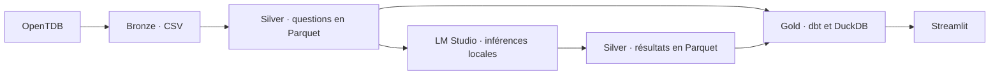

# Architecture technique

Le pipeline relie Open Trivia Database (OpenTDB) à un tableau de bord Streamlit. Le [suivi opérationnel](CURRENT.md) indique les étapes déjà réalisées.

## Choix validés

### Bronze

`collect_opentdb_complet.py` collecte les questions par catégorie, utilise un jeton de session et enregistre la progression dans un fichier local. L’extraction est conservée dans `data/bronze/questions_raw.csv` avec les champs `type`, `difficulty`, `category`, `question`, `correct_answer` et `incorrect_answers`. La liste des réponses incorrectes est sérialisée en JSON dans la cellule CSV. Les entités HTML et les valeurs sources sont conservées pour pouvoir vérifier les transformations ultérieures.

### Silver

- `data/silver/questions_clean.parquet` contiendra les questions préparées. Les transformations prévues incluent le décodage HTML, la normalisation, des contrôles qualité et l’attribution d’un `question_id` stable. Le champ `type` et les deux types de questions seront conservés.
- `data/silver/inference_results.parquet` sera alimenté par des inférences réelles. Une ligne correspondra à une question, un modèle, une variante de prompt et une répétition. La séparation des deux fichiers permet de réutiliser les questions préparées pour plusieurs exécutions. Le stockage Parquet facilite la lecture sélective des colonnes par DuckDB.

| Champ prévu | Information portée |
| --- | --- |
| `question_id` | Identifiant stable de la question |
| `model_id` | Identifiant du modèle |
| `prompt_id` | Variante du prompt |
| `repetition_id` | Numéro de répétition |
| `ai_answer` | Réponse donnée par le modèle |
| `ai_correct` | Booléen indiquant si la réponse correspond à la réponse attendue |
| `response_time` | Temps de génération en secondes |

Les réponses brutes, les paramètres de génération et les statuts d’exécution seront également conservés pour retracer les résultats.

### Gold et restitution

dbt construit les indicateurs dans DuckDB. Le niveau `staging` lit, standardise et type les sources. Le niveau `intermediate` porte les jointures et les calculs intermédiaires. Le niveau `marts` expose les tables analytiques et les indicateurs destinés à Streamlit. L’application sera développée après la construction des données Gold.

### Benchmark

Les inférences locales passeront par LM Studio. Le premier modèle retenu est Gemma 4 E2B.

1. **Comparer les modèles** sur la précision, la latence moyenne et médiane, le respect du format, la stabilité des réponses et les erreurs communes.
2. **Mesurer l’influence du prompt** avec P0 pour la question directe de référence, P1 pour le rôle d’expert en culture générale, P2 pour la possibilité de répondre `INCONNU` et P3 pour l’indication du domaine.
3. **Mesurer l’influence des caractéristiques des questions** par catégorie, difficulté et type, puis en croisant ces dimensions et en comparant les prompts par catégorie. Le champ `type` permet notamment de contextualiser la précision globale. Un choix uniforme au hasard donne 25 % de bonnes réponses sur un QCM à quatre choix et 50 % sur une question vrai/faux.

## Choix à arbitrer

- Règles de traitement des libellés répétés avant la préparation de Silver.
- Modèle relationnel détaillé, dictionnaire des données et méthode de construction des identifiants stables.
- Deuxième LLM.
- Règles d’évaluation, en particulier pour `INCONNU` et les réponses hors format.
- Protocole détaillé du benchmark.
